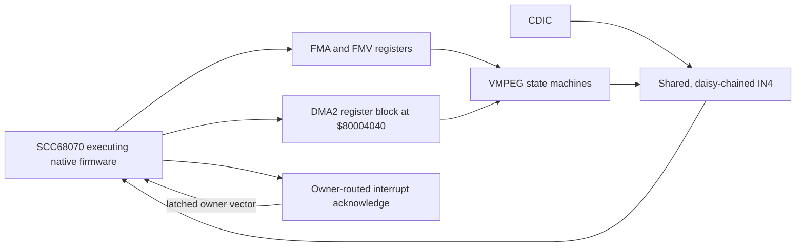

# VMPEG architecture and provenance

This document is the concise reviewer-facing map of E-Di's Philips 22ER9141
VMPEG Digital Video Cartridge implementation. It describes the M3 target on a
Mono-I/CD-i 220 F2 player, the runtime ownership of each stage, and the source
provenance behind the implementation.

The detailed behavior ledger remains in [`mpeg-dvc-plan.md`](mpeg-dvc-plan.md),
and boundaries shared with the base player remain in
[`hardware-boundaries.md`](hardware-boundaries.md).

## Scope

M3 emulates the optional 22ER9141 VMPEG cartridge while executing the bundled
CD-i system ROM and VMPEG OS-9 driver firmware natively on the SCC68070. The
cartridge contributes MPEG-1 video and Layer-II audio decoding, 1 MiB of system
extension RAM, 512 KiB of decoder/reference RAM, an external video plane, and
decoded audio.

This architecture does not describe IMPEG, the CD-i 490/Mono-IV mainboard, or
the later 22ER9144/22ER9956 cartridge variants. Those belong to M4 or a later
player-generation milestone.

## End-to-end path

```mermaid
flowchart LR
    Guest["CD-i application and CD-RTOS"]
    Drivers["Native /mv and /ma drivers from VMPEG firmware"]
    Disc["Mode-2 Form-2 sectors"]
    CDIC["CDIC buffers and CDFM PCLs"]
    RAM["Main RAM"]
    DMA2["SCC68070 DMA2 / DMAREQ2"]
    FIFO["VMPEG transfer register and input FIFO"]
    Demux["Incremental MPEG system/PES demux"]
    Video["MPEG-1 video decoder"]
    Pictures["Decoded and presentation-timed picture queues"]
    MCD251["MCD251 source window and display origin"]
    Clock["15 MHz / White Book 13.5 MHz output converter"]
    MCD212["MCD212 external plane and base-plane composition"]
    Raster["Core digital raster"]
    Frontend["Frontend aperture, pixel aspect, and optional deinterlace"]
    Audio["MPEG Layer-II decoder"]
    PCM["44.1 kHz stereo PCM"]
    Mix["Saturating CDIC + VMPEG digital mix"]
    HostAudio["Host audio output"]

    Guest --> Drivers
    Drivers --> CDIC
    Drivers --> DMA2
    Drivers --> FIFO
    Disc --> CDIC -->|"DMA0"| RAM --> DMA2 --> FIFO --> Demux
    Demux -->|"selected video PES"| Video --> Pictures --> MCD251 --> Clock --> MCD212
    MCD212 --> Raster --> Frontend
    Demux -->|"selected audio PES"| Audio --> PCM --> Mix --> HostAudio
    CDIC -->|"CD-DA / XA PCM"| Mix
    MCD212 -. "VSYNC latch" .-> Pictures
```

The native drivers, not the host frontend, decide when data moves and when
the decoders start, pause, continue, switch streams, abort, or report
completion. E-Di models the CPU-visible devices beneath those drivers; it does
not replace CD-RTOS calls or inject decoded media directly.

### Control and interrupt path

On the CD-i 220, CDIC and the FMV extension share IN4. Ownership remains
latched until the current source releases the line; interrupt acknowledge
returns that owner's programmed vector. IN5 is unused on this model.

## Hardware-visible map

| Address | Modeled function |
|---|---|
| `$D00000-$DFFFFF` | 1 MiB VMPEG system extension RAM |
| `$E01000` | External output-clock converter control; downstream of MCD251 |
| `$E03000` | FMA MPEG Layer-II/DSP-facing registers |
| `$E04000` | MCD251 FMV registers, transfer port, clocks, status and interrupts |
| `$E40000-$E7FFFF` | 256 KiB OS-9 driver firmware mapping; a 128 KiB dump mirrors once |
| `$E80000-$EFFFFF` | 512 KiB decoder/reference RAM |

The compressed-data route is CDIC to main RAM through SCC68070 DMA0, followed
by main RAM to VMPEG through the hardware's second DMA block, DMA2. The Rust
peripheral API calls that block `dma1` because its internal register arrays are
zero-based; documentation and guest-visible behavior use the hardware name
DMA2.

## Timing and presentation ownership

| Clock or event | Owner and role |
|---|---|
| 75 Hz sector cadence | CDIC/CDFM transport; it does not derive from video frame rate |
| 90 kHz SCR/PTS | MPEG system-stream timestamps and A/V presentation anchors |
| 45 kHz DCLK | VMPEG presentation clock shared by synchronized audio and video |
| VMPEG timer | Approximately 100.446 Hz (`90,000 / 896`) |
| MCD212 VSYNC | Latches a due MCD251 picture for display and sets VMPEG VSYNC status |
| 15/13.5 MHz selection | Cartridge output conversion after MCD251 and before MCD212 |

The first synchronized decoder to receive disc data establishes the shared
SCR-to-DCLK mapping. Decode completion does not itself make a picture visible:
a due picture is staged and published at the next MCD212 VSYNC. MCD251 owns the
decoded source window and origin; the downstream cartridge circuit owns White
Book horizontal clock conversion; MCD212 owns external-plane selection,
transparency, mattes, cursor, base-plane composition, and the final digital
raster.

VMPEG YCbCr conversion remains in CCIR studio range internally. Expansion from
digital 16..235 to desktop 0..255 occurs only at CLI PNG or frontend texture
presentation. The optional frontend deinterlacer changes host presentation,
not guest-visible field timing or VMPEG state.

MPEG Layer-II output is converted to 44.1 kHz stereo PCM and mixed with CDIC
audio using saturating arithmetic. Whether both sources share the same final
physical SLAVE-controlled analog attenuation and mute circuit remains an open
hardware question; the digital mixer is not evidence for that analog path.

## Implementation map

| Area | Primary implementation |
|---|---|
| Cartridge mapping, registers, clocks, demux, MP2, picture queues | `crates/cdi-core/src/dvc.rs` |
| Safe MPEG-1 video decoder | `crates/cdi-core/src/mpeg1_video.rs` and `mpeg1_tables.rs` |
| CDIC sector transport and base audio | `crates/cdi-core/src/cdic.rs` |
| DMA2 pacing, shared-IN4 arbitration, device scheduling and audio mix | `crates/cdi-core/src/machine.rs` |
| SCC68070 DMA/PIC register behavior | `crates/cdi-scc68070/src/periph.rs` |
| External-plane composition and final core raster | `crates/cdi-core/src/mcd212.rs` |
| Disc parsing and Mode-2 sector delivery | `crates/cdi-disc` |
| Host presentation and audio delivery | `crates/cdi-frontend` and `crates/cdi-cli` |

## Component provenance

| Component | Primary authority or source | Use in E-Di |
|---|---|---|
| VMPEG board, memory, register and signal boundaries | Philips 22ER9141 and CD-i 220 service manuals; Green Book R2; Philips TN 097/098/101/103/105; Motorola MCD251 Technical Summary | Original Rust device integration and tests derived from documented behavior |
| Native driver lifecycle and completion ordering | Supported VMPEG firmware plus Philips FMVDemo, FPD804 and FPD805 source | Native firmware executes on the SCC68070; Philips source may be adapted with provenance, but developer-disc images and unrelated assets are not redistributed |
| CDIC/CDFM/PCL transport | Green Book R2 and Philips technical notes | Original Rust transport, ownership diagnostics and fixtures |
| MPEG system/PES demultiplexing and timestamp mapping | ISO/IEC 11172 behavior as constrained by Green Book R2 and Philips driver evidence | Original incremental safe-Rust implementation |
| MPEG-1 video decoding | MIT-licensed `gen2brain/mpeg` commit `27c6f084c6ca342380c99a59a6a130b3f716e9d7` | Attributed safe-Rust translation; the Go unsafe pixel-view convenience is omitted and all plane access is bounds checked |
| MPEG Layer-II decoding | MIT-licensed `oxideav-mp2` crate `0.0.9` | Pinned dependency with persistent synthesis state; VMPEG framing, stream selection, timing and concealment remain E-Di integration |
| MCD251 output window and display timing | Motorola MCD251 Technical Summary, Green Book R2 and Philips notes | Original Rust register model, picture staging and VSYNC publication |
| White Book output conversion | White Book behavior, VMPEG service material and Philips Interactive Engineer 96/05 | Original downstream 15/13.5 MHz mapping; not modeled as an invented MCD251 phase register |
| MCD212 composition and host presentation boundary | MCD212 documentation, Green Book R2 and project display-geometry ledger | Original Rust composition, raster and presentation integration |
| MiSTer `CDi_MiSTer` | Commit `bbaf100b5b7ab02af3f5932492c4989d5f91323f` | Study and externally visible behavioral comparison only; no HDL or software translation |

## Clean-room and licensing boundary

- Philips specifications, service material, technical notes and supported
  firmware behavior are the primary authority.
- MiSTer is used only to corroborate externally visible behavior and to design
  original tests. Its GPL implementation is not translated into this
  repository, regardless of license compatibility.
- Similar decoder structure between E-Di and MiSTer is expected because both
  decoder lineages descend from `pl_mpeg`. E-Di's video code comes from the
  separately pinned MIT `gen2brain/mpeg` source; its VMPEG registers, DMA,
  interrupts, clocks, CD-i transport and composition are independently
  implemented from Philips/Motorola evidence.
- The only planned direct MPEG decoder adaptation is the attributed
  `gen2brain/mpeg` video translation. MPEG audio is provided by the pinned MIT
  `oxideav-mp2` dependency.
- Workspace Rust remains `unsafe_code = "deny"`.
- Supported system and DVC firmware may live in `firmware/`. Commercial game
  discs, extracted title media, private references and unrelated developer-disc
  assets must not be committed. Project-owned synthetic streams are allowed.

Third-party attribution is summarized in [`../NOTICE.md`](../NOTICE.md). Exact
reference revisions and findings are maintained in the source ledger in
[`mpeg-dvc-plan.md`](mpeg-dvc-plan.md#source-ledger).

## Verification boundaries

Tracked coverage includes:

- firmware classification and CRC-valid `/mv`, `/ma`, `RAM00` and `RAM01`
  descriptors;
- DMAREQ2 pacing, completion and shared-IN4 arbitration;
- incremental system/PES parsing, selected-stream changes and timestamp wrap;
- MPEG I/P/B ordering, repeated sequence headers and transition resets;
- Layer-II sync acquisition, stream switching and long integer clock mapping;
- display-timed picture publication, masked VSYNC status and external-video
  positioning;
- MCD212 composition, CCIR presentation range and mixed-generation detection;
- deterministic title summaries and optional local Philips FMVDemo gates.

Commercial-title traces and screenshots are optional local evidence and remain
under ignored `tests-data/local/`. They are compatibility gates, not source
material for copied media or title-specific repair.

## Deliberately unresolved

- M3.14 still needs a perceptual or presentation-overlap oracle for long-run
  A/V drift; throughput equality alone does not prove lip sync.
- The complete MCD251 coordinate-to-output equation is unavailable; visible
  position changes require synchronized register/output evidence rather than a
  guessed phase control.
- Live OS-9 memory-list validation is still needed for priority `$81`,
  priority-zero decoder RAM and the 960 KiB contiguous allocation guarantee.
- The physical analog relationship between CDIC audio, VMPEG audio and
  SLAVE-programmed attenuation/mute remains unmeasured.
- IMPEG and later player/cartridge variants are outside this architecture.
